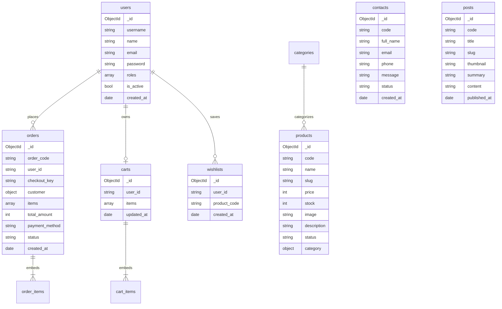

# 🌸 Shop Hoa Tươi – Website Thương Mại Điện Tử Hoa Tươi (Laravel & MongoDB)

[](https://laravel.com)
[](https://php.net)
[](https://www.mongodb.com)
[](https://getbootstrap.com)
[](https://tailwindcss.com)
[](LICENSE)

Dự án website thương mại điện tử **Shop Hoa Tươi**, được chuyển đổi (port) và hiện đại hóa từ hệ thống **C# ASP.NET MVC 5** ([luan2311/Shop-Flower](https://github.com/luan2311/Shop-Flower)) sang kiến trúc **Laravel MVC** kết hợp cơ sở dữ liệu phi quan hệ **MongoDB (NoSQL Document Store)**. Giao diện được thiết kế hiện đại, responsive mobile-first lấy cảm hứng từ phong cách tinh tế của [gochoaxinh.com](https://gochoaxinh.com).

---

## 📑 Mục Lục

- [1. Giới Thiệu Dự Án](#1-giới-thiệu-dự-án)
- [2. Công Nghệ Sử Dụng (Tech Stack)](#2-công-nghệ-sử-dụng-tech-stack)
- [3. Tính Năng Nổi Bật](#3-tính-năng-nổi-bật)
  - [3.1. Phân hệ Khách hàng (Storefront & User)](#31-phân-hệ-khách-hàng-storefront--user)
  - [3.2. Phân hệ Quản trị (Admin Dashboard)](#32-phân-hệ-quản-trị-admin-dashboard)
  - [3.3. Tương thích ngược với hệ thống C# Shop-Flower](#33-tương-thích-ngược-với-hệ-thống-c-shop-flower)
- [4. Kiến Trúc Dữ Liệu MongoDB (NoSQL Document Model)](#4-kiến-trúc-dữ-liệu-mongodb-nosql-document-model)
  - [4.1. Bảng đối chiếu SQL Server sang MongoDB](#41-bảng-đối-chiếu-sql-server-sang-mongodb)
  - [4.2. Chi tiết 8 Collections](#42-chi-tiết-8-collections)
- [5. Yêu Cầu Hệ Thống (Prerequisites)](#5-yêu-cầu-hệ-thống-prerequisites)
- [6. Hướng Dẫn Cài Đặt & Triển Khai (Setup Guide)](#6-hướng-dẫn-cài-đặt--triển-khai-setup-guide)
  - [Bước 1: Clone repository](#bước-1-clone-repository)
  - [Bước 2: Cài đặt PHP dependencies](#bước-2-cài-đặt-php-dependencies)
  - [Bước 3: Cài đặt Node dependencies & Build assets](#bước-3-cài-đặt-node-dependencies--build-assets)
  - [Bước 4: Cấu hình môi trường (.env)](#bước-4-cấu-hình-môi-trường-env)
  - [Bước 5: Khởi tạo Cơ sở dữ liệu MongoDB](#bước-5-khởi-tạo-cơ-sở-dữ-liệu-mongodb)
  - [Bước 6: Tạo liên kết Storage (Storage Link)](#bước-6-tạo-liên-kết-storage-storage-link)
  - [Bước 7: Khởi chạy ứng dụng](#bước-7-khởi-chạy-ứng-dụng)
- [7. Tài Khoản Đăng Nhập Mẫu (Demo Credentials)](#7-tài-khoản-đăng-nhập-mẫu-demo-credentials)
- [8. Kiểm Thử Tự Động (Testing & QA Suite)](#8-kiểm-thử-tự-động-testing--qa-suite)
- [9. Cấu Trúc Thư Mục Dự Án (Project Structure)](#9-cấu-trúc-thư-mục-dự-án-project-structure)
- [10. Phân Công Thành Viên & Đóng Góp (Team & Rubric)](#10-phân-công-thành-viên--đóng-góp-team--rubric)
- [11. Bản Quyền & Giấy Phép (License)](#11-bản-quyền--giấy-phép-license)

---

## 1. Giới Thiệu Dự Án

**Shop Hoa Tươi** là giải pháp toàn diện cho cửa hàng kinh doanh hoa trực tuyến, đáp ứng trải nghiệm mua sắm mượt mà từ việc chọn mẫu hoa, tìm kiếm tức thì, quản lý giỏ hàng, đặt hàng thanh toán an toàn cho đến theo dõi hành trình đơn hàng.

### Điểm nhấn kỹ thuật:
- **Chuyển dịch sang NoSQL hoàn chỉnh**: Thay vì quan hệ đa bảng phức tạp và phép `JOIN` nặng nề, hệ thống áp dụng mô hình **Embedded Document** (nhúng mảng items vào giỏ hàng và đơn hàng) và **Snapshot Pattern** (lưu thông tin sản phẩm và khách hàng tại thời điểm đặt).
- **Giao dịch an toàn & Chống Replay Attack**: Áp dụng MongoDB Transaction nguyên tử kết hợp `checkout_key` (UUID v4 + sparse unique index) giúp ngăn ngừa việc người dùng double-click hoặc gửi lại request đặt hàng nhiều lần.
- **Hoàn trả kho tự động (Inventory Rollback)**: Trừ tồn kho nguyên tử khi đặt hàng và tự động hoàn trả số lượng vào kho nếu đơn hàng bị hủy bởi quản trị viên.
- **Live Search & Wishlist AJAX**: Tìm kiếm sản phẩm thời gian thực (debounce 300ms) qua MongoDB Text Index; thêm/bớt yêu thích không reload trang.
- **Tương thích hoàn toàn hệ thống cũ**: Hỗ trợ toàn bộ routing C# ASP.NET MVC 5 URL alias và các tham số form cũ.

---

## 2. Công Nghệ Sử Dụng (Tech Stack)

| Lớp (Layer) | Công nghệ / Thư viện | Vai trò |
|---|---|---|
| **Backend Framework** | **Laravel 13 / 12** | Framework PHP hiện đại, kiến trúc MVC, Service Layer, Middleware |
| **Language Runtime** | **PHP 8.3+** | Hỗ trợ extension `mongodb` (v2.5.5+), Typing nghiêm ngặt, Eloquent ORM |
| **Database** | **MongoDB Server 8.x** | Cơ sở dữ liệu NoSQL dạng Document, hỗ trợ Replica Set Transaction |
| **MongoDB ODM** | **mongodb/laravel-mongodb** | Tích hợp Eloquent Model cho MongoDB collections |
| **Frontend UI** | **Blade Template + Bootstrap 5 + Tailwind CSS** | Giao diện chuẩn gochoaxinh.com, màu hồng pastel - xanh mint sang trọng |
| **Client Scripts** | **JavaScript (ES6+), Fetch API, Alpine.js** | Xử lý AJAX giỏ hàng, live search debounce, wishlist toggle, autocomplete |
| **Build Tools** | **Vite + PostCSS** | Đóng gói bundle CSS/JS nhanh chóng và tối ưu dung lượng |
| **Bản đồ ngoài** | **Google Maps Embed API** | Nhúng bản đồ vị trí cửa hàng tại trang Liên hệ |
| **Testing & QA** | **PHPUnit 12 + Node Playwright** | Unit Test, Feature Test, Concurrency Test, Browser E2E Automation |

---

## 3. Tính Năng Nổi Bật

### 3.1. Phân hệ Khách hàng (Storefront & User)

- 🏠 **Trang chủ sống động**:
  - Banner Slider Carousel bắt mắt.
  - Khối cam kết dịch vụ (Giao hoa trong 2 giờ, Hoa tươi 100%, Đổi trả dễ dàng, Miễn phí thiệp/banner).
  - Khối danh mục hoa kèm số lượng sản phẩm.
  - Khối sản phẩm bán chạy / nổi bật theo danh mục.
  - Khối tin tức và cẩm nang hoa tươi mới nhất.
- 🔍 **Tìm kiếm & Bộ lọc Sản phẩm (Catalog & Live Search)**:
  - Live Search gợi ý tức thì khi gõ tên hoa (debounce 300ms) truy vấn MongoDB Text Index (`$text: { $search: ... }`).
  - Lọc theo danh mục hoa (Bó hoa, Kệ chúc mừng, Giỏ hoa, Hoa cưới, Hoa sáp).
  - Lọc theo khoảng giá và sắp xếp tăng/giảm theo giá trị số thực tế (numeric sorting).
  - Phân trang chuẩn 12 sản phẩm/trang, giữ nguyên trạng thái bộ lọc trên URL.
- 🌺 **Trang Chi tiết Sản phẩm**:
  - Hình ảnh hoa rõ nét, mã hoa, tên hoa, giá niêm yết chuẩn VND.
  - Mô tả chi tiết HTML về ý nghĩa loại hoa và quy cách gói.
  - Trạng thái kho hàng (Còn hàng / Tạm hết hàng).
  - Danh sách 4 sản phẩm cùng loại gợi ý bên dưới.
- 🛒 **Giỏ hàng Thông minh (AJAX Cart)**:
  - Thêm sản phẩm vào giỏ hàng bằng AJAX không reload trang, hiển thị badge số lượng.
  - Cập nhật số lượng (+ / -) tự động tính toán lại thành tiền.
  - Xóa từng món hoặc làm rỗng giỏ hàng.
- 💳 **Thanh toán & Đặt hàng An toàn (Idempotent Checkout)**:
  - Form nhập thông tin người nhận (Họ tên, SĐT, Email, Địa chỉ, Ghi chú giao hàng).
  - Tự động điền nhanh địa chỉ giao hàng mẫu (Autocomplete).
  - Phương thức thanh toán linh hoạt: COD (Thanh toán khi nhận hàng), Chuyển khoản ngân hàng.
  - **Cơ chế Idempotent Checkout**: Sinh token duy nhất để tránh tạo đơn hàng trùng khi người dùng bấm gửi liên tiếp.
  - Chạy trong **MongoDB Transaction** đảm bảo tính toàn vẹn: trừ tồn kho và dọn giỏ hàng cùng lúc.
- ❤️ **Danh sách Yêu thích (Wishlist)**:
  - Bấm icon tim ❤️ để thêm/bớt hoa yêu thích bằng Fetch API không tải lại trang.
  - Trang quản lý Wishlist riêng cho từng tài khoản.
- 📦 **Lịch sử & Chi tiết Đơn hàng**:
  - Danh sách đơn hàng đã mua kèm trạng thái trực quan: `Chờ xử lý`, `Đang xử lý`, `Đang giao hàng`, `Đã hoàn thành`, `Đã hủy`.
  - Xem chi tiết từng đơn hàng, danh sách hoa đã mua theo giá snapshot lúc đặt.
- 📰 **Tin tức & Cẩm nang (Blog)**:
  - Danh sách bài viết kiến thức chăm sóc hoa, ý nghĩa các loài hoa.
  - Chi tiết bài viết với hình ảnh minh họa, ngày đăng chuẩn ISO.
- 📞 **Liên hệ & Tích hợp Bản đồ**:
  - Form gửi tin nhắn hỗ trợ, được validate kỹ lưỡng phía máy chủ (FormRequest).
  - Bản đồ tương tác Google Maps định vị cửa hàng.
- 👤 **Quản lý Tài khoản (Auth & Profile)**:
  - Đăng ký tài khoản, đăng nhập, quên mật khẩu, cập nhật thông tin cá nhân.
  - Hỗ trợ đăng nhập bằng cả `email` lẫn `username` (tương thích C# cũ).

---

### 3.2. Phân hệ Quản trị (Admin Dashboard)

Truy cập qua route `/admin/*`, được bảo vệ nghiêm ngặt bằng Middleware `auth` và `role:Admin`:

- 📊 **Dashboard Thống kê**:
  - Thống kê tổng số lượng: Sản phẩm, Đơn hàng, Doanh thu, Khách hàng.
  - Biểu đồ phân tích doanh thu theo chu kỳ (Endpoint `/admin/dashboard/revenue-data`).
  - Danh sách đơn hàng mới nhất cần xử lý gấp.
- 📦 **Quản lý Sản phẩm (Product CRUD)**:
  - Thêm mới, sửa, xóa sản phẩm.
  - Upload ảnh hoa lưu trữ vào `storage/app/public/products` với xem trước ảnh tức thì.
  - Bật/tắt tính năng "Tạm ngừng kinh doanh" (`stop-selling`).
  - Quản lý số lượng tồn kho (Stock quantity).
- 🏷️ **Quản lý Danh mục (Category CRUD)**:
  - Quản lý 5 danh mục chính (Bó hoa, Kệ mừng, Giỏ mừng, Hoa cưới, Hoa sáp) và thêm danh mục mới.
- 📋 **Quản lý Đơn hàng (Order Workflow)**:
  - Xem toàn bộ danh sách đơn hàng với bộ lọc trạng thái và tìm kiếm mã đơn.
  - Cập nhật tiến trình: `Pending` ➔ `Processing` ➔ `Shipped` ➔ `Completed`.
  - Hủy đơn hàng (`Cancelled`): **Hệ thống tự động hoàn lại tồn kho nguyên tử** vào MongoDB.
  - Ngăn chặn nhảy cóc trạng thái hoặc can thiệp vào đơn hàng đã hoàn tất/đã hủy.
- 👥 **Quản lý Người dùng (User Management)**:
  - Danh sách người dùng hệ thống, phân loại Admin và User.
  - Khóa / Kích hoạt tài khoản người dùng (`toggle-active`).
  - Tạo tài khoản nội bộ mới.
- 📝 **Quản lý Tin tức (Post CRUD)**:
  - Thêm, sửa, xóa bài viết tin tức kèm ảnh đại diện.
- ✉️ **Quản lý Liên hệ (Contact Messages)**:
  - Xem danh sách tin nhắn khách hàng gửi đến, chi tiết nội dung và xử lý liên hệ.

---

### 3.3. Tương thích ngược với hệ thống C# Shop-Flower

Để đảm bảo việc chuyển đổi từ C# ASP.NET MVC 5 sang Laravel không làm hỏng các liên kết cũ, hệ thống đã cấu hình đầy đủ các route fallback và alias:

| URL C# ASP.NET MVC cũ | Route Laravel tương đương | Mô tả |
|---|---|---|
| `/tat-ca-san-pham` | `Route::get('/products')` | Trang tất cả sản phẩm |
| `/bo-hoa-tuoi` | `/products?category_slug=bo-hoa-tuoi` | Danh mục Bó hoa tươi |
| `/ke-hoa-chuc-mung` | `/products?category_slug=ke-chuc-mung` | Danh mục Kệ chúc mừng |
| `/gio-hoa-chuc-mung` | `/products?category_slug=gio-hoa-chuc-mung` | Danh mục Giỏ hoa |
| `/hoa-cuoi` | `/products?category_slug=hoa-cuoi` | Danh mục Hoa cưới |
| `/hoa-sap` | `/products?category_slug=hoa-sap` | Danh mục Hoa sáp |
| `/SanPham/chi_tiet_san_pham?id=...` | `Route::get('/products/{slug}')` | Chi tiết sản phẩm |
| `/Cart/ThemGioHang` | `Route::post('/cart/add')` | Thêm vào giỏ hàng (nhận `ms`, `txtSoLuong`) |
| `/Cart/CapNhatGioHang` | `Route::patch('/cart/items/{code}')` | Cập nhật số lượng |
| `/Cart/XoaGioHang` | `Route::delete('/cart/items/{code}')` | Xóa sản phẩm khỏi giỏ |
| `/Dashboard/QL_SanPham` | `Route::get('/admin/products')` | Quản lý sản phẩm admin |
| `/Dashboard/QL_HoaDon` | `Route::get('/admin/orders')` | Quản lý hóa đơn admin |
| `/Dashboard/QL_TaiKhoan` | `Route::get('/admin/users')` | Quản lý tài khoản admin |
| `/Home/Tin_tuc` | `Route::get('/posts')` | Danh sách tin tức |

---

## 4. Kiến Trúc Dữ Liệu MongoDB (NoSQL Document Model)

### 4.1. Bảng đối chiếu SQL Server sang MongoDB

Toàn bộ CSDL từ file nguồn `QL_SHOPFLOWER_final.sql` đã được chuyển đổi thành tài liệu MongoDB chuẩn trong `database/mongodb_init.js`:

| Bảng gốc (SQL Server) | Collection MongoDB | Mô hình lưu trữ | Ghi chú thiết kế NoSQL |
|---|---|---|---|
| `LOAIHANG` | `categories` | Standalone Collection | `code`, `name`, `slug`, `description` |
| `SANPHAM` | `products` | Standalone + **Embedded Category** | Nhúng `{ code, name, slug }` của danh mục; Text Index tìm kiếm nhanh |
| `TAIKHOAN` + `VAITRO` | `users` & `roles` | Standalone + **Array of Roles** | Mảng `roles: ['Admin', 'User']`, mật khẩu bcrypt, không dùng bảng nối |
| `HOADON` + `CTHD` | `orders` | **Embedded Document** | Nhúng `customer` và mảng `items` (snapshot giá và tên hoa lúc mua) |
| `CART` + `CART_ITEM` | `carts` | **Embedded Document** | Một document cho mỗi user, mảng `items` dùng toán tử `$push`/`$pull` |
| `WISHLIST` | `wishlists` | Standalone Collection | Index kép `{ user_id: 1, product_code: 1 }` tránh trùng lặp |
| `LIENHE` | `contacts` | Standalone Collection | Quản lý tin nhắn khách hàng gửi đến |
| `TINTUC` | `posts` | Standalone Collection | Bài viết blog cẩm nang hoa tươi |

### 4.2. Chi tiết 8 Collections



---

## 5. Yêu Cầu Hệ Thống (Prerequisites)

Trước khi tiến hành cài đặt, đảm bảo máy tính đã cài đặt các công cụ sau:

- **Hệ điều hành**: Windows 10/11, macOS hoặc Linux.
- **PHP**: Phiên bản **8.3+** (ZTS hoặc NTS x64).
  - Bắt buộc kích hoạt extension: `mongodb` (phiên bản >= 2.5.0), `curl`, `mbstring`, `openssl`, `fileinfo`, `pdo_sqlite` (dùng cho bộ test nhanh).
- **Composer**: Phiên bản **2.5+**.
- **Node.js**: Phiên bản **18.x** hoặc **20.x** & **NPM**.
- **MongoDB Server**: Phiên bản **7.0+** hoặc **8.x** (Cài đặt local trên port `27017` hoặc dùng Docker / MongoDB Atlas).
- **MongoDB Shell (`mongosh`)**: Dùng để chạy script nạp dữ liệu ban đầu.

> [!TIP]
> **Dành cho người dùng Windows / Laragon:**
> Project đã tích hợp sẵn thư viện PHP MongoDB tại thư mục `.runtime/php/` (`php_mongodb.dll` và `mongodb.ini`). Nếu máy tính chưa nạp extension, bạn có thể copy file `php_mongodb.dll` vào thư mục `ext` của PHP trong Laragon và thêm `extension=mongodb` vào `php.ini`.

---

## 6. Hướng Dẫn Cài Đặt & Triển Khai (Setup Guide)

### Bước 1: Clone repository

```bash
git clone https://github.com/luan2311/shop-hoatuoi.git
cd shop-hoatuoi
```

---

### Bước 2: Cài đặt PHP dependencies

```bash
composer install
```

---

### Bước 3: Cài đặt Node dependencies & Build assets

```bash
npm install
npm run build
```

---

### Bước 4: Cấu hình môi trường (.env)

Tạo file `.env` từ file mẫu `.env.example`:

```bash
# Trên Linux / macOS:
cp .env.example .env

# Trên Windows PowerShell:
Copy-Item .env.example .env
```

Tạo Application Key:

```bash
php artisan key:generate
```

Mở file `.env` và kiểm tra cấu hình kết nối MongoDB:

```dotenv
APP_NAME="Shop Hoa Tươi"
APP_ENV=local
APP_DEBUG=true
APP_URL=http://localhost:8000

DB_CONNECTION=mongodb
MONGODB_URI=mongodb://127.0.0.1:27017
MONGODB_DATABASE=shop_hoatuoi
```

---

### Bước 5: Khởi tạo Cơ sở dữ liệu MongoDB

Hệ thống cung cấp file kịch bản `database/mongodb_init.js` nạp đầy đủ **80 sản phẩm hoa tươi**, **5 danh mục**, **3 bài viết tin tức**, tài khoản quản trị và các schema validation.

Chạy lệnh nạp dữ liệu bằng **MongoDB Shell (`mongosh`)**:

```bash
# Nạp dữ liệu vào database shop_hoatuoi:
mongosh "mongodb://127.0.0.1:27017/shop_hoatuoi" database/mongodb_init.js
```

*Hoặc mở `mongosh` trực tiếp rồi load script:*

```javascript
use shop_hoatuoi
load("database/mongodb_init.js")
```

Kết quả in ra sẽ tạo thành công các collections và indexes:
- `categories`: 5 danh mục
- `products`: 80 sản phẩm (kèm Text Index cho tìm kiếm)
- `users`: Tài khoản Admin và User mẫu
- `posts`: 3 bài cẩm nang tin tức
- `roles`, `contacts`, `orders`, `carts`, `wishlists`

---

### Bước 6: Tạo liên kết Storage (Storage Link)

Để các hình ảnh tải lên của sản phẩm và tin tức có thể hiển thị ngoài trình duyệt:

```bash
php artisan storage:link
```

---

### Bước 7: Khởi chạy ứng dụng

Khởi chạy máy chủ phát triển Laravel:

```bash
php artisan serve
```

Nếu muốn chạy song song chế độ biên dịch giao diện tức thì (Hot Reload):

```bash
npm run dev
```

Truy cập ứng dụng tại trình duyệt: **`http://127.0.0.1:8000`** hoặc **`http://localhost:8000`**.

---

## 7. Tài Khoản Đăng Nhập Mẫu (Demo Credentials)

Sau khi chạy file nạp CSDL `database/mongodb_init.js`, bạn có thể đăng nhập bằng các tài khoản sau:

| Vai trò | Tên đăng nhập (Username) | Email | Mật khẩu | Quyền hạn / Đường dẫn |
|---|---|---|---|---|
| **Quản trị viên (Admin)** | `admin` | `admin@shophoatuoi.com` | `Admin@123` | Toàn quyền quản trị hệ thống (`/admin/dashboard`) |
| **Khách hàng (User)** | `user_demo` | `user@shophoatuoi.com` | `User@123` | Khách hàng mua sắm (`/products`, `/cart`, `/wishlist`, `/account/orders`) |

> [!NOTE]
> Hệ thống hỗ trợ đăng nhập linh hoạt bằng cả **Email** hoặc **Username** trên cùng một khung đăng nhập.

---

## 8. Kiểm Thử Tự Động (Testing & QA Suite)

Hệ thống được xây dựng theo phương pháp TDD & QA nghiêm ngặt, bao gồm cả Unit Test và Feature Test với cơ chế **cô lập CSDL tự động (Database Isolation)** nhằm đảm bảo dữ liệu chạy test không ảnh hưởng đến dữ liệu phát triển.

### Chạy kiểm thử PHPUnit:

```bash
# Chạy toàn bộ test suite
php artisan test

# Hoặc chạy từng nhóm kiểm thử cụ thể:
php artisan test tests/Feature/Auth
php artisan test tests/Feature/Products
php artisan test tests/Feature/CartOperationsTest.php
php artisan test tests/Feature/OrderCheckoutTest.php
php artisan test tests/Feature/CategoryCrudTest.php
php artisan test tests/Feature/WishlistAjaxTest.php
php artisan test tests/Feature/ContactAndPostTest.php
```

### Chạy kiểm thử JavaScript / Frontend:

```bash
node tests/JavaScript/search-realtime.test.cjs
node tests/JavaScript/checkout-address-autocomplete.test.cjs
```

### Chạy kiểm thử trên Replica Set (kiểm thử giao dịch MongoDB):

```powershell
# Khởi động Replica Set local phục vụ test Transaction
.\scripts\start-tien-mongodb.ps1

# Chạy suite QA tích hợp an toàn
.\scripts\test-dung-data.ps1
```

---

## 9. Cấu Trúc Thư Mục Dự Án (Project Structure)

```text
shop-hoatuoi/
├── app/
│   ├── Http/
│   │   ├── Controllers/
│   │   │   ├── Admin/               # Controllers phân hệ Admin (Product, Category, Order, User, Post, Contact)
│   │   │   ├── Auth/                # Controllers xác thực (Login, Register, Password Reset)
│   │   │   ├── CartController.php   # Xử lý giỏ hàng AJAX
│   │   │   ├── ContactController.php# Xử lý liên hệ & form
│   │   │   ├── HomeController.php   # Hiển thị trang chủ, banner, sản phẩm hot
│   │   │   ├── OrderController.php  # Checkout an toàn & lịch sử đơn hàng
│   │   │   ├── PostController.php   # Tin tức & cẩm nang hoa tươi
│   │   │   ├── ProductController.php# Catalog, tìm kiếm live search, lọc sản phẩm
│   │   │   └── WishlistController.php # Thêm/bớt yêu thích AJAX
│   │   └── Middleware/              # Role Middleware bảo vệ Admin và User
│   ├── Models/                      # MongoDB Models (User, Product, Order, Cart, Category, Post,...)
│   └── Services/
│       └── SalesService.php         # Logic nghiệp vụ giỏ hàng, checkout transaction và hoàn kho
├── config/
│   └── database.php                 # Cấu hình driver mongodb & connections
├── database/
│   ├── mongodb_init.js              # Script khởi tạo 8 collections, validation và 80 sản phẩm
│   ├── migrations/                  # Migrations hỗ trợ MongoDB schema & index
│   └── seeders/                     # Seeders nạp dữ liệu an toàn
├── docs/                            # Tài liệu báo cáo, sơ đồ kiến trúc & nghiệm thu chất lượng
│   ├── plans/                       # Phân chia công việc 5 thành viên
│   └── BAO_CAO_DO_AN_10_DIEM.md     # Báo cáo tổng hợp tiêu chí đánh giá
├── resources/
│   └── views/
│       ├── admin/                   # Giao diện quản trị (Dashboard, Products, Orders, Categories,...)
│       ├── layouts/
│       │   ├── app.blade.php        # Layout Master khách hàng phong cách gochoaxinh.com
│       │   └── admin.blade.php      # Layout Quản trị viên
│       ├── products/                # View danh sách, bộ lọc, chi tiết hoa
│       ├── cart/                    # View giỏ hàng
│       ├── orders/                  # View thanh toán & lịch sử đơn hàng
│       ├── posts/                   # View tin tức cẩm nang
│       ├── wishlist/                # View danh sách yêu thích
│       └── contact.blade.php        # View liên hệ & Google Maps
├── routes/
│   ├── web.php                      # Route trang chủ, tin tức, liên hệ, profile
│   ├── admin.php                    # Route phân hệ quản trị (/admin/*)
│   ├── products.php                 # Route sản phẩm, tìm kiếm, C# compatibility
│   ├── sales.php                    # Route giỏ hàng, thanh toán, đơn hàng
│   └── auth.php                     # Route đăng nhập, đăng ký, đổi mật khẩu
├── scripts/                         # Script PowerShell & Python tự động hóa QA và khởi chạy
└── tests/                           # Bộ kiểm thử tự động (Feature, Unit, JavaScript)
```

---

## 10. Phân Công Thành Viên & Đóng Góp (Team & Rubric)

Dự án được xây dựng bởi nhóm 5 thành viên với sự phân chia trách nhiệm rõ ràng theo tiêu chí chấm điểm (Thang điểm 10):

| Thành viên | Trách nhiệm chính | Module phụ trách | Tiêu chí Rubric |
|---|---|---|---|
| **Member 1 (Lead)** | **Core Architecture & Phân Quyền** | Cấu hình kết nối MongoDB (`mongodb/laravel-mongodb`), Role Middleware (`Admin`/`User`), Admin Layout, Category CRUD, Admin Dashboard | **Tiêu chí 1 & 2** (Auth 2 role, CRUD, Kiến trúc NoSQL) |
| **Member 2** | **Backend & UI Sản Phẩm NoSQL** | Product CRUD trên MongoDB, Quản lý upload ảnh `storage/products`, Bộ lọc danh mục, Live Search AJAX debounce 300ms với Text Index | **Tiêu chí 1 & 5** (CRUD, Search/Paginate, Upload, AJAX) |
| **Member 3** | **Backend & UI Bán Hàng (Sales)** | Giỏ hàng MongoDB NoSQL Embedded Model, Checkout Transaction chống Replay Attack (`checkout_key`), Quản lý trạng thái đơn hàng & Hoàn kho tự động | **Tiêu chí 1 & 2** (Embedded Document, Atomic Operations, Validation) |
| **Member 4** | **Frontend Master UI & Tương Tác** | Layout Master (phong cách gochoaxinh.com), Responsive Mobile-first (375px), Wishlist AJAX không reload, Trang Liên hệ + Google Maps API, Tin tức | **Tiêu chí 3 & 5** (Giao diện chuẩn, Responsive, AJAX Wishlist, API ngoài) |
| **Member 5** | **QA Testing, Seeder & Báo Cáo** | Khởi tạo CSDL từ `mongodb_init.js` (80 SP, 5 danh mục, 3 bài viết), Bộ Test Suite PHPUnit (110+ tests pass 100%), Thiết kế sơ đồ NoSQL Schema & Báo cáo đồ án | **Tiêu chí 2 & 4** (Test Suite, Seeder NoSQL, Báo cáo & Sơ đồ UML) |

---

## 11. Bản Quyền & Giấy Phép (License)

Dự án được phát triển cho mục đích học tập và nghiên cứu công nghệ mã nguồn mở, phát hành theo giấy phép [MIT License](LICENSE).

- Giao diện tham khảo phong cách: [gochoaxinh.com](https://gochoaxinh.com).
- Codebase gốc C# ASP.NET MVC 5: [luan2311/Shop-Flower](https://github.com/luan2311/Shop-Flower).

---
*Chúc bạn có trải nghiệm tuyệt vời với **Shop Hoa Tươi – Laravel & MongoDB**! Mọi đóng góp và câu hỏi vui lòng gửi qua mục Issues hoặc tạo Pull Request.* 🌹
