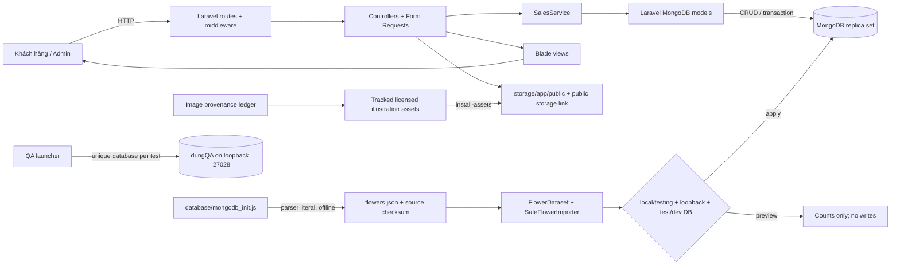
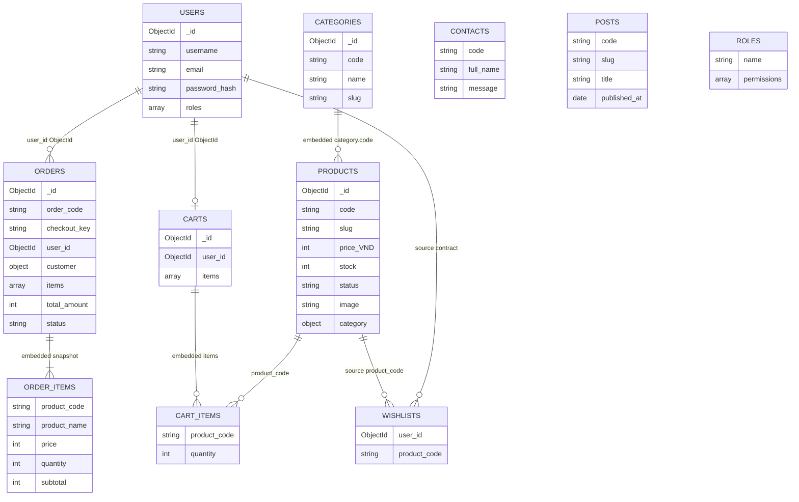
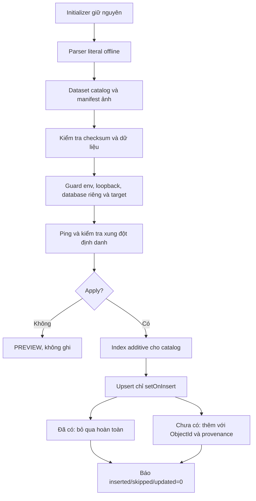
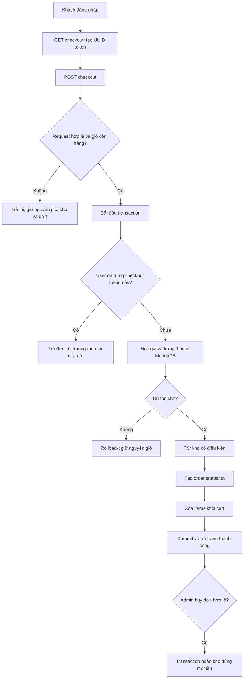
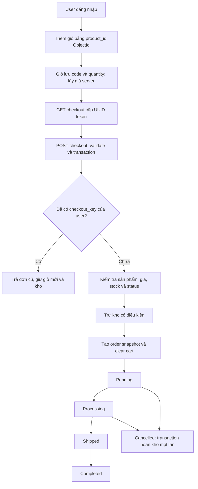

# Sơ đồ dữ liệu và luồng nghiệp vụ

Sơ đồ thể hiện hợp đồng MongoDB nguồn và phần sales/auth hiện có trên commit Tiến `89242cd`, được kiểm thử từ nhánh Dũng. Category/Post đã có dữ liệu seed nhưng model/UI tương ứng chưa chuyển xong; Role/Wishlist/Contact chưa phải module Mongo hoạt động hoàn chỉnh. Quan hệ dưới đây là liên kết logic, không phải SQL foreign key.

## Kiến trúc Laravel – MongoDB



Sales/auth được kiểm tra bằng route/model hiện có; Catalog, upload ảnh và dashboard chung chưa được vẽ như module đã tích hợp.



`CART_ITEMS` và `ORDER_ITEMS` là hai kiểu document **nhúng**, không phải hai collection riêng. Tổng collection nguồn vẫn là 9. Roles collection là dữ liệu lịch sử; auth hiện tại đọc `users.roles[]`. Đơn legacy có thể có user_id string, giá Decimal128; importer mới giữ giá integer và sales có lớp đọc legacy.

## Luồng nhập dữ liệu an toàn



Một đợt import không phải transaction toàn bộ. Lỗi kết nối/validator có thể để lại một phần insert hợp lệ; báo FAIL kèm progress và chạy lại an toàn sau review, không xóa dữ liệu.

## Activity – đặt hàng



## Sequence – checkout

```mermaid
sequenceDiagram
    actor Buyer as Khách hàng
    participant Web as Laravel route/controller
    participant Request as OrderRequest
    participant Sales as SalesService
    participant DB as MongoDB replica set

    Buyer->>Web: GET /checkout
    Web->>DB: Đọc cart và products
    DB-->>Web: Tóm tắt giỏ
    Web-->>Buyer: Form + UUID checkout_token
    Buyer->>Web: POST /checkout (token + thông tin giao hàng)
    Web->>Request: Validate token, người nhận, thanh toán
    Request-->>Web: Dữ liệu hợp lệ
    Web->>Sales: checkout(user, validated data)
    Sales->>DB: Bắt đầu transaction, tra checkout_key theo owner
    alt Token đã xử lý
        DB-->>Sales: Order cũ
        Sales-->>Web: Trả lại order cũ, không sửa cart/kho
    else Token mới
        Sales->>DB: Đọc cart/product; kiểm tra status, giá, stock
        Sales->>DB: Trừ kho có điều kiện; tạo snapshot order; clear cart
        DB-->>Sales: Ghi thành công
        Sales->>DB: Commit transaction
        Sales-->>Web: Order mới
    end
    Web-->>Buyer: Redirect /orders/success
```

Lỗi validation trả về trước khi gọi SalesService; lỗi ghi MongoDB trong transaction trả lỗi HTTP và rollback thay đổi kho/đơn/giỏ. Các nhánh lỗi được kiểm tra bằng Feature tests; sơ đồ không khẳng định Catalog hoặc trình duyệt đã nghiệm thu.

## Luồng bán hàng đang có code



Giao diện Catalog đứng trước bước thêm giỏ chưa được tích hợp. COD/Banking là lựa chọn phương thức; chưa có API thanh toán ngân hàng. Use Case nguồn: [USE_CASE.puml](USE_CASE.puml).
