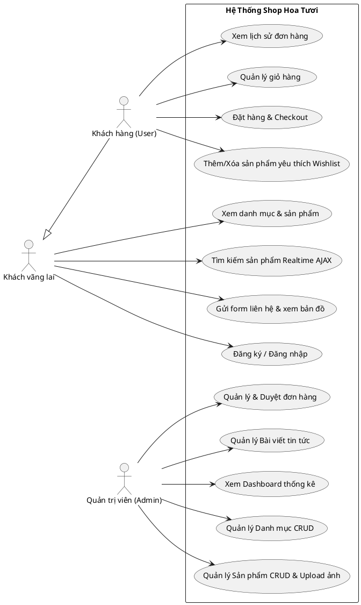

# Kế Hoạch Triển Khai & Phân Chia Công Việc Nhóm 5 Người – Shop Hoa Tươi Laravel

> **For Claude:** REQUIRED SUB-SKILL: Use superpowers:executing-plans to implement this plan task-by-task.

**Goal:** Xây dựng hoàn chỉnh website thương mại điện tử Shop Hoa Tươi bằng Laravel 12 trên Laragon, chuẩn giao diện responsive gochoaxinh.com, đạt điểm tối đa 10/10 theo thang rubric đồ án, phân bổ khối lượng đồng đều cho 5 thành viên.

**Architecture:** Laravel 12 MVC + Eloquent ORM + Breeze Auth + Custom Role Middleware (`admin`, `user`). Frontend kết hợp Blade Template, Bootstrap 5, Fetch API (AJAX live search debounce 300ms & AJAX wishlist toggle), tích hợp Google Maps API và file storage public.

**Tech Stack:** PHP 8.2+, Laravel 12, MySQL 8 (Laragon port 3306), Blade, Bootstrap 5, Vanilla JS (Fetch API), PHPUnit.

---

## 1. Bảng Phân Chia Vai Trò & Ma Trận Trách Nhiệm (5 Thành Viên)

| Thành viên | Vai trò chính | Module phụ trách | Tiêu chí chấm điểm liên quan |
|---|---|---|---|
| **Member 1 (Lead)** | Core Architecture, MongoDB & Phân quyền | Cấu hình kết nối MongoDB (mongodb/laravel-mongodb), Role Middleware, Layout Admin, Danh mục (Category CRUD), Dashboard Admin | Tiêu chí 1 (Auth, CRUD) & Tiêu chí 2 (Architecture, NoSQL Setup) |
| **Member 2** | Backend & UI Sản phẩm NoSQL | Sản phẩm CRUD trên MongoDB Collection, Image Upload, Bộ lọc danh mục, Live Search AJAX debounce truy vấn MongoDB Full-text Index | Tiêu chí 1 (CRUD, Search, Paginate) & Tiêu chí 5 (Upload, AJAX) |
| **Member 3** | Backend & UI Bán hàng (Embedded Model) | Giỏ hàng MongoDB (Embedded items), Đặt hàng NoSQL Checkout (Embedded Order Items, Atomic Operations $push/$inc), Quản lý đơn hàng | Tiêu chí 1 (CRUD Document nhúng, Validation) & Tiêu chí 2 (NoSQL Model) |
| **Member 4** | Frontend Master UI & Tương tác | Layout User (gochoaxinh style), Wishlist AJAX trên MongoDB, Liên hệ + Google Maps API, Tin tức (Posts Collection) | Tiêu chí 3 (UI/Responsive), Tiêu chí 5 (AJAX Wishlist, API ngoài) |
| **Member 5** | QA Testing, Seeder MongoDB & Báo cáo | Test Suite (PHPUnit Feature Tests), Khởi tạo dữ liệu MongoDB từ mongodb_init.js (80 SP, 5 danh mục), Thiết kế sơ đồ NoSQL Document Schema Model, Slide | Tiêu chí 2 (Test, Seeder NoSQL), Tiêu chí 4 (Báo cáo, UML, NoSQL Schema) |

---

## 2. Quy Chuẩn Làm Việc Nhóm & Quy Trình Git (Tránh Conflict)

1. **Nhánh Git chính:**
   - `main`: Chỉ merge code khi đã test pass 100%.
   - `develop`: Nhánh tích hợp chung.
   - Nhánh tính năng cá nhân:
     - Member 1: `feature/auth-category-admin`
     - Member 2: `feature/product-search`
     - Member 3: `feature/cart-checkout-orders`
     - Member 4: `feature/user-ui-wishlist-contact`
     - Member 5: `feature/testing-docs-seeder`

2. **Quy tắc phân định thư mục/tập tin (Zero-Conflict):**
   - **Routes:** 
     - Member 1 quản lý khung `routes/web.php` và tạo các file route con: `routes/admin.php`, `routes/user.php` để các thành viên include, tránh sửa chung 1 file `web.php`.
   - **Controllers:** Phân chia theo namespace rõ ràng:
     - `app/Http/Controllers/Admin/` (Category, Product, Order, Post).
     - `app/Http/Controllers/` (Product, Cart, Order, Wishlist, Contact, Post).
   - **Views:**
     - `resources/views/layouts/admin.blade.php` (Member 1).
     - `resources/views/layouts/app.blade.php` (Member 4).
     - `resources/views/admin/` (Member 1, 2, 3 quản lý theo từng thư mục con riêng biệt).
     - `resources/views/products/` (Member 2).
     - `resources/views/cart/`, `resources/views/orders/` (Member 3).
     - `resources/views/contact.blade.php`, `resources/views/posts/`, `resources/views/wishlist/` (Member 4).

---

## 3. Kế Hoạch Triển Khai Theo Từng Thành Viên (Bite-Sized Tasks)

---

### PHẦN 1: MEMBER 1 – CORE ARCHITECTURE, AUTH & CATEGORY

#### Task 1.1: Tạo Role Middleware và cấu hình bảo vệ Route Admin/User
**Files:**
- Create: `app/Http/Middleware/RoleMiddleware.php`
- Modify: `bootstrap/app.php`
- Test: `tests/Feature/RoleMiddlewareTest.php`

**Step 1: Write the failing test**
```php
// tests/Feature/RoleMiddlewareTest.php
namespace Tests\Feature;

use App\Models\Role;
use App\Models\User;
use Illuminate\Foundation\Testing\RefreshDatabase;
use Tests\TestCase;

class RoleMiddlewareTest extends TestCase
{
    use RefreshDatabase;

    public function test_user_without_admin_role_cannot_access_admin_dashboard(): void
    {
        $userRole = Role::create(['name' => 'User', 'description' => 'Khách hàng']);
        $user = User::factory()->create();
        $user->roles()->attach($userRole->id);

        $response = $this->actingAs($user)->get('/admin/dashboard');
        $response->assertStatus(403);
    }
}
```

**Step 2: Run test to verify it fails**
Run: `php artisan test tests/Feature/RoleMiddlewareTest.php`
Expected: FAIL (Route `/admin/dashboard` not defined or 404).

**Step 3: Write minimal implementation**
1. Tạo middleware:
```php
// app/Http/Middleware/RoleMiddleware.php
namespace App\Http\Middleware;

use Closure;
use Illuminate\Http\Request;
use Symfony\Component\HttpFoundation\Response;

class RoleMiddleware
{
    public function handle(Request $request, Closure $next, string $role): Response
    {
        if (! $request->user() || ! $request->user()->hasRole($role)) {
            abort(403, 'Bạn không có quyền truy cập trang này.');
        }

        return $next($request);
    }
}
```
2. Đăng ký alias trong `bootstrap/app.php`:
```php
$middleware->alias([
    'role' => \App\Http\Middleware\RoleMiddleware::class,
]);
```
3. Tạo route test trong `routes/web.php` với middleware `['auth', 'role:Admin']`.

**Step 4: Run test to verify it passes**
Run: `php artisan test tests/Feature/RoleMiddlewareTest.php`
Expected: PASS.

**Step 5: Commit**
```bash
git add app/Http/Middleware/RoleMiddleware.php bootstrap/app.php tests/Feature/RoleMiddlewareTest.php routes/web.php
git commit -m "feat(auth): add RoleMiddleware and admin route protection"
```

---

#### Task 1.2: Xây dựng Admin Layout Base và Dashboard Overview
**Files:**
- Create: `resources/views/layouts/admin.blade.php`
- Create: `resources/views/admin/dashboard.blade.php`
- Create: `app/Http/Controllers/Admin/DashboardController.php`
- Test: `tests/Feature/AdminDashboardTest.php`

**Step 1: Write the failing test**
```php
// tests/Feature/AdminDashboardTest.php
namespace Tests\Feature;

use App\Models\Role;
use App\Models\User;
use Illuminate\Foundation\Testing\RefreshDatabase;
use Tests\TestCase;

class AdminDashboardTest extends TestCase
{
    use RefreshDatabase;

    public function test_admin_can_view_dashboard(): void
    {
        $adminRole = Role::create(['name' => 'Admin', 'description' => 'Quản trị']);
        $admin = User::factory()->create();
        $admin->roles()->attach($adminRole->id);

        $response = $this->actingAs($admin)->get('/admin/dashboard');
        $response->assertStatus(200);
        $response->assertSee('Tổng quan quản trị');
    }
}
```

**Step 2: Run test to verify it fails**
Run: `php artisan test tests/Feature/AdminDashboardTest.php`
Expected: FAIL.

**Step 3: Write minimal implementation**
1. Viết `DashboardController` lấy số liệu tổng: sản phẩm, danh mục, đơn hàng, người dùng.
2. Viết `resources/views/layouts/admin.blade.php` gồm sidebar Bootstrap 5 (Danh mục, Sản phẩm, Đơn hàng, Bài viết, Người dùng).
3. Viết `resources/views/admin/dashboard.blade.php` hiển thị 4 card thống kê trực quan.

**Step 4: Run test to verify it passes**
Run: `php artisan test tests/Feature/AdminDashboardTest.php`
Expected: PASS.

**Step 5: Commit**
```bash
git add app/Http/Controllers/Admin/DashboardController.php resources/views/layouts/admin.blade.php resources/views/admin/dashboard.blade.php tests/Feature/AdminDashboardTest.php
git commit -m "feat(admin): build admin dashboard layout and overview cards"
```

---

#### Task 1.3: Quản lý Danh mục sản phẩm (Admin Category CRUD)
**Files:**
- Create: `app/Http/Requests/CategoryRequest.php`
- Create: `app/Http/Controllers/Admin/CategoryController.php`
- Create: `resources/views/admin/categories/index.blade.php`
- Create: `resources/views/admin/categories/create.blade.php`
- Create: `resources/views/admin/categories/edit.blade.php`
- Test: `tests/Feature/CategoryCrudTest.php`

**Step 1: Write the failing test**
```php
// tests/Feature/CategoryCrudTest.php
namespace Tests\Feature;

use App\Models\Category;
use App\Models\Role;
use App\Models\User;
use Illuminate\Foundation\Testing\RefreshDatabase;
use Tests\TestCase;

class CategoryCrudTest extends TestCase
{
    use RefreshDatabase;

    public function test_admin_can_create_category(): void
    {
        $adminRole = Role::create(['name' => 'Admin']);
        $admin = User::factory()->create();
        $admin->roles()->attach($adminRole->id);

        $response = $this->actingAs($admin)->post('/admin/categories', [
            'name' => 'Hoa Lan Hồ Điệp',
            'slug' => 'hoa-lan-ho-diep',
        ]);

        $response->assertRedirect('/admin/categories');
        $this->assertDatabaseHas('categories', ['slug' => 'hoa-lan-ho-diep']);
    }
}
```

**Step 2: Run test to verify it fails**
Run: `php artisan test tests/Feature/CategoryCrudTest.php`
Expected: FAIL.

**Step 3: Write minimal implementation**
1. Tạo `CategoryRequest` validate `name` (required, max:100), `slug` (unique:categories).
2. Viết `CategoryController` đủ 7 RESTful actions (`index`, `create`, `store`, `edit`, `update`, `destroy`). Tự động `Str::slug` nếu người dùng không nhập slug.
3. Tạo views Blade Bootstrap hiển thị bảng danh sách, modal/trang thêm và sửa danh mục có flash message `toast`.

**Step 4: Run test to verify it passes**
Run: `php artisan test tests/Feature/CategoryCrudTest.php`
Expected: PASS.

**Step 5: Commit**
```bash
git add app/Http/Requests/CategoryRequest.php app/Http/Controllers/Admin/CategoryController.php resources/views/admin/categories/ tests/Feature/CategoryCrudTest.php
git commit -m "feat(category): implement admin category CRUD with validation"
```

---

### PHẦN 2: MEMBER 2 – BACKEND & FRONTEND SẢN PHẨM & TÌM KIẾM AJAX

#### Task 2.1: Admin Product CRUD kèm xử lý Upload ảnh vào Storage Public
**Files:**
- Create: `app/Http/Requests/ProductRequest.php`
- Create: `app/Http/Controllers/Admin/ProductController.php`
- Create: `resources/views/admin/products/index.blade.php`
- Create: `resources/views/admin/products/create.blade.php`
- Create: `resources/views/admin/products/edit.blade.php`
- Test: `tests/Feature/AdminProductTest.php`

**Step 1: Write the failing test**
```php
// tests/Feature/AdminProductTest.php
namespace Tests\Feature;

use App\Models\Category;
use App\Models\Role;
use App\Models\User;
use Illuminate\Foundation\Testing\RefreshDatabase;
use Illuminate\Http\UploadedFile;
use Illuminate\Support\Facades\Storage;
use Tests\TestCase;

class AdminProductTest extends TestCase
{
    use RefreshDatabase;

    public function test_admin_can_create_product_with_image(): void
    {
        Storage::fake('public');
        $adminRole = Role::create(['name' => 'Admin']);
        $admin = User::factory()->create();
        $admin->roles()->attach($adminRole->id);
        $cat = Category::create(['name' => 'Hoa Bó', 'slug' => 'hoa-bo']);

        $image = UploadedFile::fake()->image('flower.jpg');

        $response = $this->actingAs($admin)->post('/admin/products', [
            'code'        => 'SP999',
            'name'        => 'Bó Cúc Tsubaki',
            'category_id' => $cat->id,
            'price'       => 500000,
            'stock'       => 20,
            'status'      => 'Còn hàng',
            'image'       => $image,
            'description' => 'Mô tả chi tiết',
        ]);

        $response->assertRedirect('/admin/products');
        $this->assertDatabaseHas('products', ['code' => 'SP999']);
        Storage::disk('public')->assertExists('products/' . $image->hashName());
    }
}
```

**Step 2: Run test to verify it fails**
Run: `php artisan test tests/Feature/AdminProductTest.php`
Expected: FAIL.

**Step 3: Write minimal implementation**
1. `ProductRequest`: Validate `code` (unique:products), `name`, `price` (numeric, min:0), `stock` (integer, min:0), `image` (image|mimes:jpeg,png,jpg,webp|max:2048), `category_id` (exists:categories,id).
2. `Admin/ProductController`:
   - Store & Update lưu file bằng `Storage::disk('public')->putFile('products', $request->file('image'))`.
   - Update: Nếu có ảnh mới thì xóa ảnh cũ.
   - Destroy: Xóa sản phẩm và xóa file ảnh tương ứng.
3. Blade views: Bảng sản phẩm có preview ảnh nhỏ, form create/edit có `enctype="multipart/form-data"`.

**Step 4: Run test to verify it passes**
Run: `php artisan test tests/Feature/AdminProductTest.php`
Expected: PASS.

**Step 5: Commit**
```bash
git add app/Http/Requests/ProductRequest.php app/Http/Controllers/Admin/ProductController.php resources/views/admin/products/ tests/Feature/AdminProductTest.php
git commit -m "feat(product): implement admin product CRUD with public image upload"
```

---

#### Task 2.2: Frontend Product Listing, Filter danh mục & Chi tiết sản phẩm
**Files:**
- Create: `app/Http/Controllers/ProductController.php`
- Create: `resources/views/products/index.blade.php`
- Create: `resources/views/products/show.blade.php`
- Test: `tests/Feature/FrontendProductTest.php`

**Step 1: Write the failing test**
```php
// tests/Feature/FrontendProductTest.php
namespace Tests\Feature;

use App\Models\Category;
use App\Models\Product;
use Illuminate\Foundation\Testing\RefreshDatabase;
use Tests\TestCase;

class FrontendProductTest extends TestCase
{
    use RefreshDatabase;

    public function test_guest_can_view_product_list_paginated_12_items(): void
    {
        $cat = Category::create(['name' => 'Bó Hoa', 'slug' => 'bo-hoa']);
        Product::factory()->count(15)->create(['category_id' => $cat->id]);

        $response = $this->get('/products');
        $response->assertStatus(200);
        $response->assertViewHas('products');
        $this->assertCount(12, $response->viewData('products'));
    }
}
```

**Step 2: Run test to verify it fails**
Run: `php artisan test tests/Feature/FrontendProductTest.php`
Expected: FAIL.

**Step 3: Write minimal implementation**
1. `ProductController`:
   - `index(Request $request)`: Lọc theo `category_id` hoặc `category_slug`, sắp xếp giá tăng/giảm, paginate 12 bản ghi/trang: `$query->paginate(12)->withQueryString()`.
   - `show($slug)`: Tìm sản phẩm theo slug, lấy kèm sản phẩm cùng danh mục liên quan (4 sản phẩm).
2. Blade views: Grid sản phẩm chuẩn style gochoaxinh (ảnh bo góc, badge giá tiền định dạng `number_format($price, 0, ',', '.') . ' đ'`, nút mua ngay, nút yêu thích tim).

**Step 4: Run test to verify it passes**
Run: `php artisan test tests/Feature/FrontendProductTest.php`
Expected: PASS.

**Step 5: Commit**
```bash
git add app/Http/Controllers/ProductController.php resources/views/products/ tests/Feature/FrontendProductTest.php
git commit -m "feat(product): create frontend catalog, category filters and product detail"
```

---

#### Task 2.3: Tìm kiếm sản phẩm Realtime qua AJAX (Debounce 300ms)
**Files:**
- Modify: `app/Http/Controllers/ProductController.php:searchAjax`
- Create: `public/js/search-realtime.js`
- Modify: `resources/views/layouts/app.blade.php` (nhúng search modal / dropdown)
- Test: `tests/Feature/ProductSearchAjaxTest.php`

**Step 1: Write the failing test**
```php
// tests/Feature/ProductSearchAjaxTest.php
namespace Tests\Feature;

use App\Models\Category;
use App\Models\Product;
use Illuminate\Foundation\Testing\RefreshDatabase;
use Tests\TestCase;

class ProductSearchAjaxTest extends TestCase
{
    use RefreshDatabase;

    public function test_ajax_search_returns_json_matching_products(): void
    {
        $cat = Category::create(['name' => 'Hoa Hồng', 'slug' => 'hoa-hong']);
        Product::create([
            'code' => 'SP1',
            'name' => 'Bó Hoa Hồng Đỏ Ecuador',
            'price' => 700000,
            'category_id' => $cat->id,
            'slug' => 'bo-hoa-hong-do-ecuador',
        ]);

        $response = $this->getJson('/api/products/search?q=Ecuador');
        $response->assertStatus(200);
        $response->assertJsonFragment(['name' => 'Bó Hoa Hồng Đỏ Ecuador']);
    }
}
```

**Step 2: Run test to verify it fails**
Run: `php artisan test tests/Feature/ProductSearchAjaxTest.php`
Expected: FAIL.

**Step 3: Write minimal implementation**
1. Thêm endpoint `/api/products/search` trong controller trả về JSON (tối đa 6 sản phẩm gồm: id, name, price, formatted_price, slug, image_url).
2. Viết file `public/js/search-realtime.js` dùng `setTimeout` làm debounce 300ms, gọi Fetch API và render kết quả vào dropdown dưới thanh input tìm kiếm.

**Step 4: Run test to verify it passes**
Run: `php artisan test tests/Feature/ProductSearchAjaxTest.php`
Expected: PASS.

**Step 5: Commit**
```bash
git add app/Http/Controllers/ProductController.php public/js/search-realtime.js resources/views/layouts/app.blade.php tests/Feature/ProductSearchAjaxTest.php routes/web.php
git commit -m "feat(search): implement realtime AJAX search with 300ms debounce"
```

---

### PHẦN 3: MEMBER 3 – GIỎ HÀNG, ĐẶT HÀNG & QUẢN LÝ HÓA ĐƠN

#### Task 3.1: Quản lý Giỏ hàng (CartController - Thêm, Sửa số lượng, Xóa, Clear)
**Files:**
- Create: `app/Http/Controllers/CartController.php`
- Create: `resources/views/cart/index.blade.php`
- Test: `tests/Feature/CartOperationsTest.php`

**Step 1: Write the failing test**
```php
// tests/Feature/CartOperationsTest.php
namespace Tests\Feature;

use App\Models\Category;
use App\Models\Product;
use App\Models\User;
use Illuminate\Foundation\Testing\RefreshDatabase;
use Tests\TestCase;

class CartOperationsTest extends TestCase
{
    use RefreshDatabase;

    public function test_user_can_add_product_to_database_cart(): void
    {
        $user = User::factory()->create();
        $cat = Category::create(['name' => 'Hoa Giỏ', 'slug' => 'hoa-gio']);
        $product = Product::create([
            'code' => 'SP01',
            'name' => 'Giỏ Cẩm Chướng',
            'price' => 350000,
            'stock' => 10,
            'category_id' => $cat->id,
            'slug' => 'gio-cam-chuong',
        ]);

        $response = $this->actingAs($user)->post('/cart/add', [
            'product_id' => $product->id,
            'quantity'   => 2,
        ]);

        $response->assertRedirect('/cart');
        $this->assertDatabaseHas('cart_items', [
            'product_id' => $product->id,
            'quantity'   => 2,
        ]);
    }
}
```

**Step 2: Run test to verify it fails**
Run: `php artisan test tests/Feature/CartOperationsTest.php`
Expected: FAIL.

**Step 3: Write minimal implementation**
1. Viết `CartController`:
   - `index()`: Lấy cart của user đang đăng nhập (hoặc khởi tạo nếu chưa có), load quan hệ `cartItems.product`.
   - `add(Request $request)`: Thêm hoặc cộng dồn số lượng nếu sản phẩm đã có trong cart.
   - `update(Request $request)`: Cập nhật số lượng (giới hạn theo `stock` tồn kho).
   - `remove($id)`: Xóa 1 item khỏi giỏ.
   - `clear()`: Xóa sạch giỏ hàng.
2. Blade view `resources/views/cart/index.blade.php`: Bảng giỏ hàng hiển thị ảnh, tên, đơn giá, ô nhập số lượng có nút `+` `-`, tổng tiền tạm tính và nút "Tiến hành thanh toán".

**Step 4: Run test to verify it passes**
Run: `php artisan test tests/Feature/CartOperationsTest.php`
Expected: PASS.

**Step 5: Commit**
```bash
git add app/Http/Controllers/CartController.php resources/views/cart/ tests/Feature/CartOperationsTest.php routes/web.php
git commit -m "feat(cart): implement database-backed shopping cart operations"
```

---

#### Task 3.2: Module Đặt hàng & Thanh toán (Checkout & Order Creation)
**Files:**
- Create: `app/Http/Requests/OrderRequest.php`
- Create: `app/Http/Controllers/OrderController.php`
- Create: `resources/views/cart/checkout.blade.php`
- Create: `resources/views/orders/success.blade.php`
- Test: `tests/Feature/OrderCheckoutTest.php`

**Step 1: Write the failing test**
```php
// tests/Feature/OrderCheckoutTest.php
namespace Tests\Feature;

use App\Models\Cart;
use App\Models\CartItem;
use App\Models\Category;
use App\Models\Product;
use App\Models\User;
use Illuminate\Foundation\Testing\RefreshDatabase;
use Tests\TestCase;

class OrderCheckoutTest extends TestCase
{
    use RefreshDatabase;

    public function test_user_can_checkout_cart_to_create_order(): void
    {
        $user = User::factory()->create();
        $cat = Category::create(['name' => 'Hoa Giỏ', 'slug' => 'hoa-gio']);
        $product = Product::create([
            'code' => 'SP01', 'name' => 'Giỏ Hoa', 'price' => 300000,
            'stock' => 10, 'category_id' => $cat->id, 'slug' => 'gio-hoa',
        ]);
        $cart = Cart::create(['user_id' => $user->id]);
        CartItem::create(['cart_id' => $cart->id, 'product_id' => $product->id, 'quantity' => 2]);

        $response = $this->actingAs($user)->post('/checkout', [
            'receiver_name'    => 'Nguyễn Văn A',
            'receiver_phone'   => '0901234567',
            'receiver_address' => '123 Nguyễn Trãi, Q.5, TP.HCM',
            'payment_method'   => 'COD',
            'note'             => 'Giao giờ hành chính',
        ]);

        $this->assertDatabaseHas('orders', [
            'user_id'       => $user->id,
            'receiver_name' => 'Nguyễn Văn A',
            'total'         => 600000,
            'status'        => 'Pending',
        ]);
        $this->assertDatabaseCount('order_details', 1);
        $this->assertDatabaseCount('cart_items', 0); // Cart phải rỗng sau checkout
    }
}
```

**Step 2: Run test to verify it fails**
Run: `php artisan test tests/Feature/OrderCheckoutTest.php`
Expected: FAIL.

**Step 3: Write minimal implementation**
1. `OrderRequest`: Validate `receiver_name` (required), `receiver_phone` (required|regex:/^0[0-9]{9,10}$/), `receiver_address` (required), `payment_method` (required|in:COD,Banking).
2. `OrderController::store`: Dùng `DB::transaction()`:
   - Tạo bản ghi `orders`.
   - Lặp qua `cartItems` để insert vào `order_details` (kèm giá thời điểm mua).
   - Trừ `stock` của sản phẩm tương ứng.
   - Xóa các `cart_items`.
3. Blade view `resources/views/cart/checkout.blade.php`: Cột trái là Form thông tin người nhận, cột phải là tóm tắt đơn hàng.

**Step 4: Run test to verify it passes**
Run: `php artisan test tests/Feature/OrderCheckoutTest.php`
Expected: PASS.

**Step 5: Commit**
```bash
git add app/Http/Requests/OrderRequest.php app/Http/Controllers/OrderController.php resources/views/cart/checkout.blade.php resources/views/orders/success.blade.php tests/Feature/OrderCheckoutTest.php routes/web.php
git commit -m "feat(order): implement checkout, database transaction order creation, stock deduction"
```

---

#### Task 3.3: Lịch sử đơn hàng phía User & Quản trị đơn hàng Admin
**Files:**
- Create: `resources/views/orders/index.blade.php` (User history)
- Create: `resources/views/orders/show.blade.php` (User detail)
- Create: `app/Http/Controllers/Admin/OrderController.php`
- Create: `resources/views/admin/orders/index.blade.php`
- Create: `resources/views/admin/orders/show.blade.php`
- Test: `tests/Feature/AdminOrderManagementTest.php`

**Step 1: Write the failing test**
```php
// tests/Feature/AdminOrderManagementTest.php
namespace Tests\Feature;

use App\Models\Order;
use App\Models\Role;
use App\Models\User;
use Illuminate\Foundation\Testing\RefreshDatabase;
use Tests\TestCase;

class AdminOrderManagementTest extends TestCase
{
    use RefreshDatabase;

    public function test_admin_can_update_order_status(): void
    {
        $adminRole = Role::create(['name' => 'Admin']);
        $admin = User::factory()->create();
        $admin->roles()->attach($adminRole->id);

        $order = Order::create([
            'user_id'          => $admin->id,
            'total'            => 500000,
            'receiver_name'    => 'Test',
            'receiver_address' => 'Address',
            'receiver_phone'   => '0901234567',
            'status'           => 'Pending',
        ]);

        $response = $this->actingAs($admin)->patch("/admin/orders/{$order->id}/status", [
            'status' => 'Shipped',
        ]);

        $response->assertRedirect();
        $this->assertDatabaseHas('orders', ['id' => $order->id, 'status' => 'Shipped']);
    }
}
```

**Step 2: Run test to verify it fails**
Run: `php artisan test tests/Feature/AdminOrderManagementTest.php`
Expected: FAIL.

**Step 3: Write minimal implementation**
1. User: Route `/account/orders` xem danh sách đơn hàng đã đặt của cá nhân và chi tiết từng đơn.
2. Admin: Route `/admin/orders` xem toàn bộ đơn hàng kèm bộ lọc trạng thái (`Pending`, `Processing`, `Shipped`, `Completed`, `Cancelled`). Có nút chọn đổi trạng thái nhanh.

**Step 4: Run test to verify it passes**
Run: `php artisan test tests/Feature/AdminOrderManagementTest.php`
Expected: PASS.

**Step 5: Commit**
```bash
git add app/Http/Controllers/Admin/OrderController.php resources/views/orders/ resources/views/admin/orders/ tests/Feature/AdminOrderManagementTest.php routes/web.php
git commit -m "feat(order-admin): implement customer order history and admin order status management"
```

---

### PHẦN 4: MEMBER 4 – MASTER UI USER, WISHLIST AJAX, LIÊN HỆ & TIN TỨC

#### Task 4.1: Master Layout Frontend (Bootstrap 5 gochoaxinh theme & Trang chủ)
**Files:**
- Create: `resources/views/layouts/app.blade.php` (thay thế layout Breeze mặc định)
- Create: `resources/views/home.blade.php`
- Modify: `routes/web.php:get('/')`
- Test: `tests/Feature/HomePageTest.php`

**Step 1: Write the failing test**
```php
// tests/Feature/HomePageTest.php
namespace Tests\Feature;

use Illuminate\Foundation\Testing\RefreshDatabase;
use Tests\TestCase;

class HomePageTest extends TestCase
{
    use RefreshDatabase;

    public function test_homepage_loads_successfully_with_header_and_banners(): void
    {
        $response = $this->get('/');
        $response->assertStatus(200);
        $response->assertSee('Shop Hoa Tươi');
    }
}
```

**Step 2: Run test to verify it fails**
Run: `php artisan test tests/Feature/HomePageTest.php`
Expected: FAIL (Hiện tại trang chủ trả về welcome mặc định của Laravel).

**Step 3: Write minimal implementation**
1. Xây dựng `resources/views/layouts/app.blade.php`:
   - Top banner thông báo miễn phí ship.
   - Header: Logo cửa hàng hoa, Search bar realtime, Icon giỏ hàng có badge số lượng, Icon Wishlist có badge số lượng, Dropdown tài khoản.
   - Navbar Menu: Trang chủ, Danh mục sản phẩm (dropdown), Về chúng tôi, Tin tức, Liên hệ.
   - Footer: Thông tin shop, chính sách giao hoa 2h, hotline, bản quyền.
2. Tạo `resources/views/home.blade.php`: Hero carousel banner hoa tươi, Khối cam kết (Giao hoa 2h, 100% tươi mới), Khối sản phẩm bán chạy, Khối tin tức mới.

**Step 4: Run test to verify it passes**
Run: `php artisan test tests/Feature/HomePageTest.php`
Expected: PASS.

**Step 5: Commit**
```bash
git add resources/views/layouts/app.blade.php resources/views/home.blade.php routes/web.php tests/Feature/HomePageTest.php
git commit -m "feat(ui): build gochoaxinh style master layout and homepage"
```

---

#### Task 4.2: Wishlist Yêu thích bằng AJAX (Không reload trang)
**Files:**
- Create: `app/Http/Controllers/WishlistController.php`
- Create: `resources/views/wishlist/index.blade.php`
- Create: `public/js/wishlist-ajax.js`
- Test: `tests/Feature/WishlistAjaxTest.php`

**Step 1: Write the failing test**
```php
// tests/Feature/WishlistAjaxTest.php
namespace Tests\Feature;

use App\Models\Category;
use App\Models\Product;
use App\Models\User;
use Illuminate\Foundation\Testing\RefreshDatabase;
use Tests\TestCase;

class WishlistAjaxTest extends TestCase
{
    use RefreshDatabase;

    public function test_authenticated_user_can_toggle_wishlist_via_ajax(): void
    {
        $user = User::factory()->create();
        $cat = Category::create(['name' => 'Hoa Bó', 'slug' => 'hoa-bo']);
        $product = Product::create([
            'code' => 'SP1', 'name' => 'Hoa Tulip', 'price' => 300000,
            'category_id' => $cat->id, 'slug' => 'hoa-tulip',
        ]);

        // Toggle lần 1: Thêm vào wishlist
        $response1 = $this->actingAs($user)->postJson('/wishlist/toggle', ['product_id' => $product->id]);
        $response1->assertStatus(200)->assertJson(['status' => 'added']);
        $this->assertDatabaseHas('wishlists', ['user_id' => $user->id, 'product_id' => $product->id]);

        // Toggle lần 2: Xóa khỏi wishlist
        $response2 = $this->actingAs($user)->postJson('/wishlist/toggle', ['product_id' => $product->id]);
        $response2->assertStatus(200)->assertJson(['status' => 'removed']);
        $this->assertDatabaseMissing('wishlists', ['user_id' => $user->id, 'product_id' => $product->id]);
    }
}
```

**Step 2: Run test to verify it fails**
Run: `php artisan test tests/Feature/WishlistAjaxTest.php`
Expected: FAIL.

**Step 3: Write minimal implementation**
1. `WishlistController::toggle`: Nhận `product_id`, kiểm tra nếu đã tồn tại thì xóa, nếu chưa thì thêm mới; trả về JSON `{ status: 'added'|'removed', count: total_count }`.
2. `public/js/wishlist-ajax.js`: Bắt sự kiện click vào nút tim ❤, gửi fetch request với CSRF token, đổi icon từ tim rỗng sang tim đặc màu đỏ và cập nhật số trên navbar tức thì.
3. Tạo trang `resources/views/wishlist/index.blade.php` hiển thị danh sách sản phẩm đã lưu vào yêu thích.

**Step 4: Run test to verify it passes**
Run: `php artisan test tests/Feature/WishlistAjaxTest.php`
Expected: PASS.

**Step 5: Commit**
```bash
git add app/Http/Controllers/WishlistController.php public/js/wishlist-ajax.js resources/views/wishlist/index.blade.php tests/Feature/WishlistAjaxTest.php routes/web.php
git commit -m "feat(wishlist): implement ajax toggle wishlist without page reload"
```

---

#### Task 4.3: Trang Liên hệ (Validation + Tích hợp Google Maps Iframe API) & Tin tức
**Files:**
- Create: `app/Http/Requests/ContactRequest.php`
- Create: `app/Http/Controllers/ContactController.php`
- Create: `app/Http/Controllers/PostController.php`
- Create: `resources/views/contact.blade.php`
- Create: `resources/views/posts/index.blade.php`, `resources/views/posts/show.blade.php`
- Test: `tests/Feature/ContactAndPostTest.php`

**Step 1: Write the failing test**
```php
// tests/Feature/ContactAndPostTest.php
namespace Tests\Feature;

use Illuminate\Foundation\Testing\RefreshDatabase;
use Tests\TestCase;

class ContactAndPostTest extends TestCase
{
    use RefreshDatabase;

    public function test_user_can_submit_contact_form(): void
    {
        $response = $this->post('/contact', [
            'name'    => 'Trần Thị B',
            'email'   => 'tranthib@gmail.com',
            'phone'   => '0912345678',
            'message' => 'Cần tư vấn mẫu hoa cưới phong cách hiện đại.',
        ]);

        $response->assertRedirect('/contact');
        $this->assertDatabaseHas('contacts', ['email' => 'tranthib@gmail.com']);
    }
}
```

**Step 2: Run test to verify it fails**
Run: `php artisan test tests/Feature/ContactAndPostTest.php`
Expected: FAIL.

**Step 3: Write minimal implementation**
1. `ContactRequest`: Validate `name`, `email` (email), `phone`, `message`.
2. `ContactController`: Lưu vào bảng `contacts`, redirect kèm toast message thông báo "Gửi liên hệ thành công! Cửa hàng sẽ liên hệ lại sớm nhất."
3. `resources/views/contact.blade.php`: Cột trái là Form liên hệ, cột phải là iframe Google Maps Embed của địa chỉ shop (đáp ứng tiêu chí tích hợp API ngoài).
4. `PostController` & views: Hiển thị bài viết tin tức cắm hoa, ý nghĩa hoa với ảnh bìa và ngày đăng.

**Step 4: Run test to verify it passes**
Run: `php artisan test tests/Feature/ContactAndPostTest.php`
Expected: PASS.

**Step 5: Commit**
```bash
git add app/Http/Requests/ContactRequest.php app/Http/Controllers/ContactController.php app/Http/Controllers/PostController.php resources/views/contact.blade.php resources/views/posts/ tests/Feature/ContactAndPostTest.php routes/web.php
git commit -m "feat(contact-post): add contact form with google maps embed and blog module"
```

---

### PHẦN 5: MEMBER 5 – QA TESTING, SEEDER DATA & BÁO CÁO ERD/UML

#### Task 5.1: Chuẩn hóa Seeder Dữ liệu Mẫu & File Ảnh Sản Phẩm
**Files:**
- Modify: `database/seeders/DatabaseSeeder.php`
- Create: thư mục ảnh `storage/app/public/products/`
- Test: `tests/Feature/SeederIntegrityTest.php`

**Step 1: Write the failing test**
```php
// tests/Feature/SeederIntegrityTest.php
namespace Tests\Feature;

use Illuminate\Foundation\Testing\RefreshDatabase;
use Tests\TestCase;

class SeederIntegrityTest extends TestCase
{
    use RefreshDatabase;

    public function test_database_seeder_populates_required_minimum_dataset(): void
    {
        $this->seed();

        $this->assertDatabaseHas('roles', ['name' => 'Admin']);
        $this->assertDatabaseHas('roles', ['name' => 'User']);
        $this->assertDatabaseHas('users', ['email' => 'admin@shophoatuoi.com']);
        $this->assertGreaterThanOrEqual(5, \App\Models\Category::count());
        $this->assertGreaterThanOrEqual(10, \App\Models\Product::count());
    }
}
```

**Step 2: Run test to verify it fails**
Run: `php artisan test tests/Feature/SeederIntegrityTest.php`
Expected: Chạy thử để kiểm tra tính toàn vẹn dữ liệu seeder.

**Step 3: Write minimal implementation**
1. Bổ sung dữ liệu đa dạng cho `DatabaseSeeder.php`: tối thiểu 15-20 sản phẩm thuộc 5 danh mục để phục vụ phân trang (12 sp/trang).
2. Chuẩn bị ảnh mẫu hoa tươi chất lượng cao lưu vào `storage/app/public/products/`.
3. Đảm bảo chạy lệnh `php artisan storage:link` để thư mục `public/storage` nhận diện ảnh.

**Step 4: Run test to verify it passes**
Run: `php artisan test tests/Feature/SeederIntegrityTest.php`
Expected: PASS.

**Step 5: Commit**
```bash
git add database/seeders/DatabaseSeeder.php tests/Feature/SeederIntegrityTest.php
git commit -m "feat(seeder): populate comprehensive sample data and verify image storage links"
```

---

#### Task 5.2: Bộ Test E2E Toàn Trình (Customer Journey & Admin Workflow)
**Files:**
- Create: `tests/Feature/FullCustomerJourneyTest.php`

**Step 1: Write the test**
```php
// tests/Feature/FullCustomerJourneyTest.php
namespace Tests\Feature;

use App\Models\Category;
use App\Models\Product;
use App\Models\Role;
use App\Models\User;
use Illuminate\Foundation\Testing\RefreshDatabase;
use Tests\TestCase;

class FullCustomerJourneyTest extends TestCase
{
    use RefreshDatabase;

    public function test_full_customer_journey_from_viewing_to_admin_fulfillment(): void
    {
        // 1. Setup Roles
        $adminRole = Role::create(['name' => 'Admin']);
        $userRole  = Role::create(['name' => 'User']);

        $admin = User::factory()->create();
        $admin->roles()->attach($adminRole->id);

        $customer = User::factory()->create();
        $customer->roles()->attach($userRole->id);

        $cat = Category::create(['name' => 'Hoa Hồng', 'slug' => 'hoa-hong']);
        $product = Product::create([
            'code' => 'HOA01', 'name' => 'Bó Hồng Đỏ', 'price' => 500000,
            'stock' => 10, 'category_id' => $cat->id, 'slug' => 'bo-hong-do',
        ]);

        // 2. Khách xem trang chi tiết
        $res = $this->actingAs($customer)->get("/products/{$product->slug}");
        $res->assertStatus(200);

        // 3. Khách thêm vào giỏ hàng
        $res = $this->actingAs($customer)->post('/cart/add', [
            'product_id' => $product->id,
            'quantity'   => 1,
        ]);
        $res->assertRedirect('/cart');

        // 4. Khách checkout đặt hàng
        $res = $this->actingAs($customer)->post('/checkout', [
            'receiver_name'    => 'Nguyễn Văn A',
            'receiver_phone'   => '0988776655',
            'receiver_address' => '456 Lê Lợi, Q.1',
            'payment_method'   => 'COD',
        ]);
        $res->assertRedirect('/orders/success');

        // 5. Admin đăng nhập và duyệt đơn hàng
        $order = \App\Models\Order::first();
        $this->assertNotNull($order);
        $this->assertEquals('Pending', $order->status);

        $res = $this->actingAs($admin)->patch("/admin/orders/{$order->id}/status", [
            'status' => 'Completed',
        ]);
        $res->assertRedirect();
        $this->assertEquals('Completed', $order->fresh()->status);
    }
}
```

**Step 2 & 4: Run test to verify it passes**
Run: `php artisan test tests/Feature/FullCustomerJourneyTest.php`
Expected: PASS toàn bộ luồng.

**Step 5: Commit**
```bash
git add tests/Feature/FullCustomerJourneyTest.php
git commit -m "test(e2e): add complete end-to-end customer journey and admin fulfillment test"
```

---

#### Task 5.3: Tài liệu Đồ án (Sơ đồ ERD, Use Case UML & Báo cáo Thuyết trình)
**Files:**
- Create: `docs/ERD_DATABASE.md`
- Create: `docs/USECASE_UML.puml`
- Create: `docs/BAO_CAO_DO_AN_10_DIEM.md`

**Step 1: Thiết kế Sơ đồ Use Case (PlantUML)**


**Step 2: Viết Báo cáo cấu trúc 10 điểm**
Biên soạn báo cáo chi tiết bao gồm:
1. Giới thiệu đề tài & Công nghệ sử dụng.
2. Thiết kế Cơ sở dữ liệu (Chi tiết 8 Collections MongoDB, cấu trúc Embedded Documents và Text Indexes).
3. Kiến trúc mã nguồn Laravel 12 (Middleware, FormRequest, Service/Controller).
4. Minh chứng đáp ứng từng tiêu chí trong Rubric chấm điểm.

**Step 3: Commit**
```bash
git add docs/ERD_DATABASE.md docs/USECASE_UML.puml docs/BAO_CAO_DO_AN_10_DIEM.md
git commit -m "docs: finalize project report, database ERD and PlantUML use-case diagrams"
```

---

## 4. Bảng Checklist Tiến Độ Nghiệm Thu 5 Người

### Checklist Thành Viên 1 (Lead & Auth/Category)
- [x] Khởi tạo Git repo và phân quyền branch cho các thành viên.
- [x] Viết `RoleMiddleware` kiểm tra role `Admin`/`User` và chặn 403 khi truy cập trái phép.
- [x] Xây dựng Admin Layout base chuẩn Bootstrap 5 responsive.
- [x] Hoàn thiện Admin Category CRUD (Validate tên, slug, thông báo toast).
- [x] Viết xong `RoleMiddlewareTest` và `CategoryCrudTest` (100% PASS).

### Checklist Thành Viên 2 (Product & Search)
- [ ] Xây dựng Admin Product CRUD kèm upload ảnh vào `storage/app/public/products/`.
- [ ] FormRequest validation cho sản phẩm (mã SP unique, giá tiền, ảnh hợp lệ).
- [ ] Giao diện catalog sản phẩm ngoài frontend, phân trang đúng 12 sp/trang.
- [ ] Bộ lọc sản phẩm theo danh mục và sắp xếp theo giá.
- [ ] AJAX Search Realtime với cơ chế Debounce 300ms không reload trang.
- [ ] Viết xong `AdminProductTest`, `FrontendProductTest`, `ProductSearchAjaxTest` (100% PASS).

### Checklist Thành Viên 3 (Cart, Checkout & Orders)
- [ ] Module Giỏ hàng lưu DB (`carts`, `cart_items`): thêm sp, đổi số lượng, xóa item, làm trống.
- [ ] Trang Checkout thanh toán kèm FormRequest validate số điện thoại, địa chỉ nhận.
- [ ] Xử lý transaction: tạo `orders`, insert `order_details`, trừ tồn kho `stock`, làm sạch giỏ.
- [ ] Trang xem lịch sử đơn hàng cá nhân của khách hàng (`/account/orders`).
- [ ] Trang quản lý đơn hàng Admin (lọc trạng thái, chuyển đổi Pending -> Processing -> Shipped -> Completed).
- [ ] Viết xong `CartOperationsTest`, `OrderCheckoutTest`, `AdminOrderManagementTest` (100% PASS).

### Checklist Thành Viên 4 (UI/UX, Wishlist AJAX & Contact/Blog)
- [ ] Master Layout Frontend (`layouts/app.blade.php`) chuẩn màu sắc hoa tươi gochoaxinh.com.
- [ ] Kiểm tra responsive trên mobile (iPhone SE 375px) không bị vỡ giao diện hay tràn ngang.
- [ ] Chức năng Wishlist AJAX toggle icon tim đỏ không load lại trang kèm counter trên navbar.
- [ ] Trang Liên hệ validate form lưu DB và nhúng iframe Google Maps API thực tế.
- [ ] Module Tin tức cắm hoa/ý nghĩa hoa (Danh sách + Xem chi tiết).
- [ ] Viết xong `HomePageTest`, `WishlistAjaxTest`, `ContactAndPostTest` (100% PASS).

### Checklist Thành Viên 5 (QA Testing, Seeder & Báo cáo)
- [ ] Bổ sung Seeder dữ liệu mẫu phong phú (tối thiểu 15-20 sản phẩm, đủ 5 danh mục).
- [ ] Chạy `php artisan storage:link` và kiểm tra hiển thị toàn bộ ảnh sản phẩm.
- [ ] Chạy kiểm thử toàn trình `FullCustomerJourneyTest` và toàn bộ test suite: `php artisan test`.
- [ ] Thiết kế sơ đồ mô hình dữ liệu NoSQL Document Schema (Collections & Embedded Structure).
- [ ] Thiết kế sơ đồ Use Case UML bằng PlantUML.
- [ ] Soạn thảo file báo cáo đồ án và outline slide thuyết trình đáp ứng đầy đủ thang 10 điểm.

---

## 5. Bảng Đối Chiếu Tiêu Chí Chấm Điểm (10/10 Rubric)

| Tiêu chí | Điểm | Hạng mục đối chiếu | Người phụ trách chính |
|---|:---:|---|---|
| **Tiêu chí 1: Chức năng nghiệp vụ & Auth** | **4.0đ** | - CRUD ít nhất 2 bảng quan hệ (`products ↔ categories`, `orders ↔ order_details`)<br>- Phân quyền 2 role: Admin & User<br>- Tìm kiếm & Phân trang sản phẩm (12 sp/trang)<br>- Form validation đầy đủ tất cả các trường | Thành viên 1, 2, 3 |
| **Tiêu chí 2: Kiến trúc kỹ thuật & CSDL** | **2.5đ** | - Sử dụng Eloquent ORM 100% (không dùng raw SQL)<br>- Có đủ Migration + DatabaseSeeder dữ liệu mẫu<br>- Chuẩn cấu trúc MVC, Middleware, FormRequest, Blade Template | Cả nhóm (Lead Member 1 & QA Member 5) |
| **Tiêu chí 3: Giao diện & Trải nghiệm (UI/UX)** | **1.5đ** | - Giao diện Bootstrap 5 hài hòa phong cách gochoaxinh.com<br>- Đảm bảo Responsive hoàn toàn trên mobile 375px, tablet, desktop | Thành viên 4 & Thành viên 1 |
| **Tiêu chí 4: Báo cáo kỹ thuật & Thuyết trình** | **1.0đ** | - Báo cáo đồ án chi tiết, sơ đồ mô hình NoSQL Document Schema chuẩn mực<br>- Sơ đồ Use Case UML trực quan | Thành viên 5 |
| **Tiêu chí 5: Kỹ thuật nâng cao & Tích hợp** | **1.0đ** | - Upload file ảnh vào Storage Public an toàn<br>- AJAX Wishlist & AJAX Live Search Realtime<br>- Tích hợp Google Maps Embed API | Thành viên 2 & Thành viên 4 |
| **TỔNG CỘNG** | **10.0đ** | **ĐẠT ĐIỂM TỐI ĐA** | **CẢ NHÓM (5 THÀNH VIÊN)** |
